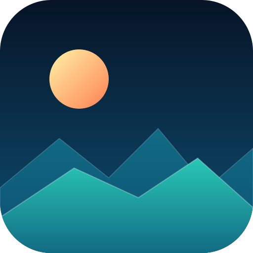
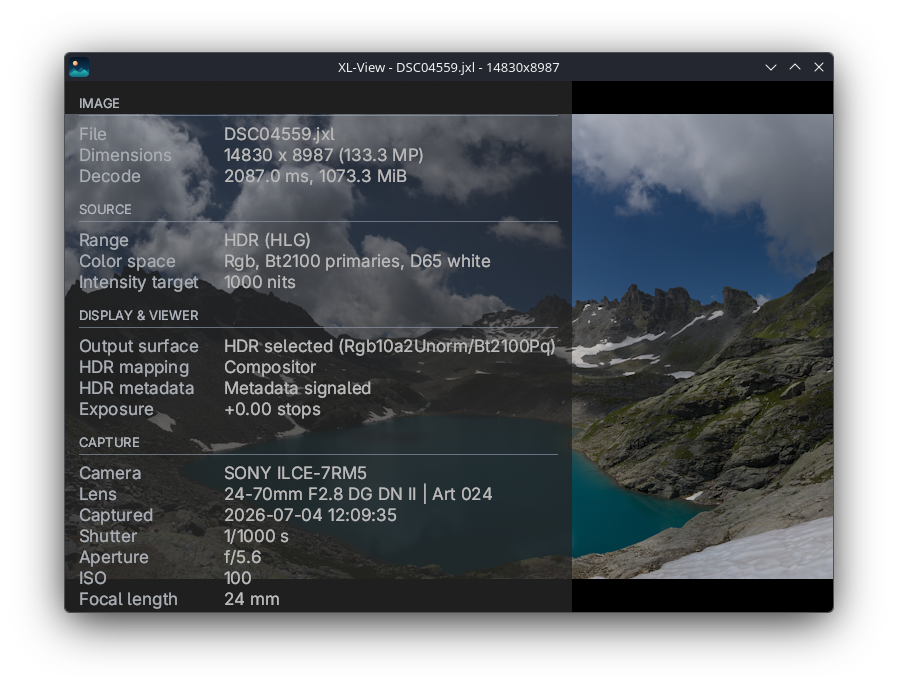

<div align="center">
  

  # XL-View

  **A minimalist HDR image viewer optimized for large images.**

  [](https://github.com/andrinbr/xl-view/actions/workflows/ci.yml)
  
  [](https://sonarcloud.io/summary/new_code?id=andrinbr_xl-view)
  [](https://sonarcloud.io/summary/new_code?id=andrinbr_xl-view)

  
</div>

XL-View is a native HDR still-image viewer for Linux, Windows, and macOS. It
targets JPEG XL and handles large images such as panoramas.

## Features

- **HDR output:** present images through BT.2100 PQ on HDR displays or sRGB on SDR displays.
  HDR images are tone-mapped when they exceed the display's available brightness range.
- **Accurate color:** preserve HDR and color profile information through the image-processing pipeline
- **Responsive large-image viewing:** open panoramas and other large images without blocking the UI, with smooth panning
- **Sharp scaling:** high-quality resampling for a detailed view
- **Image cache and preloading:** keep recent images in memory and preload adjacent files for faster browsing
- **Metadata overlay:** inspect image, output, and EXIF details without leaving the viewer
- **Exposure adjustment:** brighten or darken an image to inspect highlights and shadows
- **Selectable backgrounds:** assess contrast, edges, and transparency on different backgrounds
- **Display diagnostics:** show a test pattern and runtime/display information

## Installation

Prebuilt packages for Linux and Windows (x86_64) and macOS (Apple silicon)
are available from the
[releases page](https://github.com/andrinbr/xl-view/releases).

### Linux

Download the AppImage, make it executable, and run it:

```console
chmod +x xl-view-vX.Y.Z-linux-x86_64.AppImage
./xl-view-vX.Y.Z-linux-x86_64.AppImage path/to/image.jxl
```

As an alternative to running it directly, you can integrate the AppImage into
your desktop with an AppImage manager such as
[Gear Lever](https://github.com/mijorus/gearlever). Point Gear Lever at the
downloaded file and it handles installation and the menu entry.

### macOS

Download the DMG and drag XL-View into Applications. XL-View is currently
unsigned, so macOS may block it on first launch. Remove its quarantine
attribute before opening it:

```console
xattr -dr com.apple.quarantine /Applications/XL-View.app
```

### Windows

Download either the Setup executable or the portable ZIP. Setup installs
XL-View for the current user. The portable ZIP can be extracted anywhere and
run without installation.
The Windows binaries are currently unsigned, so Windows may show a SmartScreen
warning when they are first run.

### Building from source

The required Rust compiler is configured in
[rust-toolchain.toml](rust-toolchain.toml).

```console
git clone https://github.com/andrinbr/xl-view.git
cd xl-view
cargo build --release --locked
./target/release/xl-view path/to/image.jxl
```

Or install it into your Cargo bin directory:

```console
cargo install --locked --path .
```

To build release packages yourself, follow the instructions for the
[AppImage](packaging/linux/appimage/README.md), the
[macOS package](packaging/macos/README.md), or the
[Windows packages](packaging/windows/README.md).

## Requirements

- **A compatible graphics backend:** XL-View uses Vulkan on Linux, Vulkan or
  DirectX 12 on Windows, and Metal on macOS.
- **A native Wayland session on Linux:** there is no X11 fallback. HDR output
  additionally requires compositor HDR and Wayland color-management support.
- **HDR support:** an HDR-capable display and compatible display environment
  are required for the full experience. SDR displays still work, but HDR images
  are tone-mapped down to SDR.

## Usage

```text
Usage: xl-view [OPTIONS] [IMAGE]

Arguments:
  [IMAGE]  Image to open

Options:
      --diagnostics              Show a test pattern and print runtime/display diagnostics
      --output <OUTPUT>          Select the display output encoding [default: auto] [possible values: auto, pq, sdr]
      --background <BACKGROUND>  Select the background used outside and behind transparent image pixels [default: black] [possible values: black, middle-gray, white, checkerboard]
      --cache <MIB>              Decoded-image cache budget in MiB [default: 25% of system RAM, at least 2048, a value of 0 disables the cache]
      --gpu-memory <MIB>         Maximum GPU image memory in MiB [default: 1024]
  -h, --help                     Print help
  -V, --version                  Print version
```

Open an image by passing it on the command line, dropping a `.jxl` file onto
the window, or pressing `O` / `Ctrl+O` to use the file picker. With no image
argument, the viewer shows a welcome screen. Use `--diagnostics` to display
the color-bar test pattern instead.

By default, the viewer uses HDR output when the display supports it and sRGB
otherwise. Use `--output pq` or `--output sdr` to require a mode,
`--background` to change what shows behind transparent pixels, and `--cache` /
`--gpu-memory` to tune memory use.

## Controls

### Keyboard

| Key | Action |
| --- | --- |
| `O` / `Ctrl+O` | Open an image |
| `F` | Fit image to window |
| `1` / Numpad `1` | 1:1 (one image pixel per logical pixel) |
| `+` / `=` / Numpad `+` | Zoom in |
| `-` / Numpad `-` | Zoom out |
| `W` `A` `S` `D` | Pan up / left / down / right |
| `←` / `→` | Previous / next image in folder |
| `[` / `]` | Decrease / increase exposure |
| `R` | Reset view and exposure |
| `B` | Cycle background (black, middle gray, white, checkerboard) |
| `I` | Toggle image/output/EXIF metadata overlay |
| `F11` / `Enter` | Toggle fullscreen |
| `Esc` | Leave fullscreen |
| `Q` / `Ctrl+Q` | Quit |

### Mouse and touchpad

| Input | Action |
| --- | --- |
| Left-drag | Pan |
| Scroll wheel | Zoom in / out |
| Two-finger scroll | Pan |
| Pinch | Zoom in / out |
| Primary double-click | Toggle fullscreen |

## Supported image formats

Currently JPEG XL (`.jxl`) only. 

Supported source encodings include SDR, PQ, HLG, and linear RGB (including scRGB).
All can be displayed in either HDR or SDR mode.

## Troubleshooting

- **No HDR or washed-out colors:** make sure HDR is enabled in your display
  environment and that your display actually supports it.
- **Check the display details:** press `I` to inspect the selected output and
  image information, or run `xl-view --diagnostics` for a detailed report.
- **Wrong output selected:** use `--output pq` or `--output sdr` to override
  automatic selection. If PQ output is unavailable, XL-View reports why.
- **It won't start:** on Linux, confirm you are using a native Wayland session.
  Also confirm that a working Vulkan driver is installed.
- **More detail:** set `RUST_LOG=xl_view=debug` for debug logging to stderr.

## Architecture

XL-View works like this (simplified):

1. **Decode:** A JPEG XL file is read on a background worker so the window stays
   responsive, even for very large images.
2. **Store:** Each image is converted once into a single high-precision
   (16-bit-per-channel) buffer that the rest of the app draws from.
3. **Cache:** Recently viewed images are cached, and adjacent images are
   preloaded when the cache budget allows, reducing delays when browsing.
4. **Draw:** The GPU displays the image while a higher-quality CPU resize
   produces a sharp result once you stop panning.
5. **Display:** The image is prepared for the active display and shown in HDR
   or SDR as appropriate.

## Contributing

Feedback and questions are welcome in
[GitHub Discussions](https://github.com/andrinbr/xl-view/discussions), and bug
reports belong in [Issues](https://github.com/andrinbr/xl-view/issues). This is
a small open-source project, so please keep reports focused and include your
operating system, display environment, GPU/driver, and `--diagnostics` output
where relevant.

## License

Copyright information is available in [COPYRIGHT](COPYRIGHT). XL-View is
licensed under GPL-3.0-only, see [LICENSE](LICENSE). License information for
Rust dependencies is available in
[THIRD-PARTY-LICENSES.html](docs/legal/THIRD-PARTY-LICENSES.html). The bundled Adwaita
Sans font is licensed under the SIL Open Font License 1.1, see
[AdwaitaSans-LICENSE.txt](assets/fonts/AdwaitaSans-LICENSE.txt).
